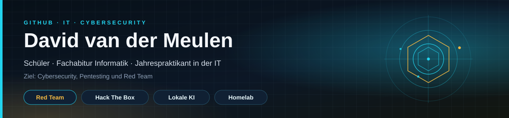
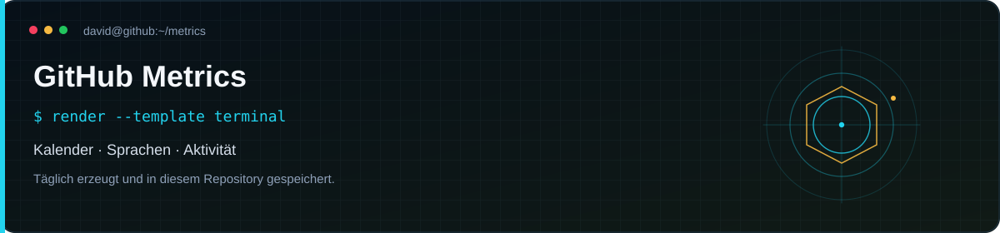

  

  

  
  
  
  
  

Schüler im Fachabitur Informatik und Jahrespraktikant in der IT. Ich will in die Cybersecurity, mit Schwerpunkt Pentesting und Red Team, und lerne das praktisch auf Hack The Box.

Daneben baue ich an lokaler KI, an einem Homelab und an Webprojekten. Robotik, 3D-Druck und Gründen gehören dazu.

*Student in IT, aiming at cybersecurity and red-team work.*

## Fokus

<table>
  <tr>
    <td width="33%" valign="top">
      <strong>Cybersecurity</strong> 
      Pentesting und Red Team. Praktisch üben auf Hack The Box.
    </td>
    <td width="33%" valign="top">
      <strong>Künstliche Intelligenz</strong> 
      Lokale LLMs, RAG und Sprachagenten.
    </td>
    <td width="33%" valign="top">
      <strong>Homelab</strong> 
      Server und Virtualisierung mit Proxmox und Cisco UCS.
    </td>
  </tr>
  <tr>
    <td width="33%" valign="top">
      <strong>Robotik und 3D-Druck</strong> 
      Hardware, Steuerung und Druck mit Bambu Lab.
    </td>
    <td width="33%" valign="top">
      <strong>Webentwicklung</strong> 
      TypeScript, Next.js und Payload CMS.
    </td>
    <td width="33%" valign="top">
      <strong>Gründen</strong> 
      Aus Ideen eigene Projekte machen.
    </td>
  </tr>
</table>

## Aktuelles Projekt

<table>
  <tr>
    <td valign="top">
      <strong>lebk-ki-assistent</strong> 
      Lokaler KI-Assistent fürs LEBK: Chatbot, Sprachagent und Roboter. 
      Privates Repository
    </td>
  </tr>
</table>

## Stack

  <a href="https://skillicons.dev">
    <picture>
      <source media="(prefers-color-scheme: dark)" srcset="https://skillicons.dev/icons?i=ts,js,py,react,nextjs,nodejs,html,css,tailwind,docker,linux,bash,git,github,vscode,raspberrypi,arduino&amp;perline=9&amp;theme=dark" />
      <source media="(prefers-color-scheme: light)" srcset="https://skillicons.dev/icons?i=ts,js,py,react,nextjs,nodejs,html,css,tailwind,docker,linux,bash,git,github,vscode,raspberrypi,arduino&amp;perline=9&amp;theme=light" />
      
    </picture>
  </a>

TypeScript, JavaScript, Python, React, Next.js, Node.js, HTML, CSS, Tailwind, Docker, Linux, Bash, Git, GitHub, VS Code, Raspberry Pi und Arduino. Im Web-Stack zusätzlich Payload CMS.

## GitHub

Statistiken und die Beitragsserie, darunter der Aktivitätsgraph und die Metrics-Übersicht aus diesem Repository.

<table>
  <tr>
    <td align="center" width="54%">
      
    </td>
    <td align="center" width="46%">
      
    </td>
  </tr>
</table>

  

<!--
  assets/github-metrics.svg wird von .github/workflows/metrics.yml ersetzt.
  Dafür das Repository-Secret METRICS_TOKEN anlegen (classic PAT, keine Scopes).
  Die Schritte stehen als Kommentar in der Workflow-Datei.
-->

  

Austausch zu Red Team, lokaler KI und Homelab gerne hier auf GitHub.
