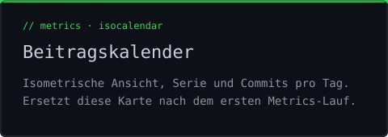
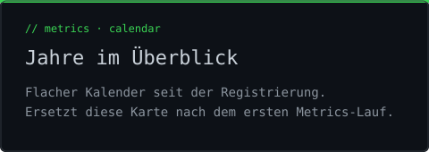
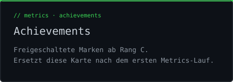
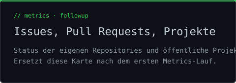
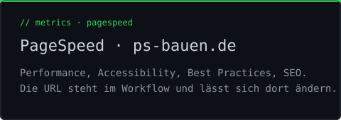

  

  

  
  
  
  
  

Ich mache das Fachabitur Informatik und ein Jahrespraktikum in der IT. Als Nächstes will ich ins Pentesting, Richtung Red Team. Auf Hack The Box übe ich das an Maschinen, nicht nur an Writeups.

Neben der Schule baue ich, was ich selbst benutzen will: lokale Sprachmodelle, ein Homelab, Webseiten. Wenn etwas hängen bleibt, soll daraus ein eigenes Projekt werden.

*IT student learning pentesting on Hack The Box, aiming at red team work.*

## Woran ich arbeite

<table>
  <tr>
    <td width="33%" valign="top">
      <strong>Cybersecurity</strong> 
      Pentesting und Red Team, geübt auf Hack The Box.
    </td>
    <td width="33%" valign="top">
      <strong>Lokale KI</strong> 
      LLMs, RAG und Sprachagenten, die bei mir laufen.
    </td>
    <td width="33%" valign="top">
      <strong>Homelab</strong> 
      Proxmox und Cisco UCS.
    </td>
  </tr>
  <tr>
    <td width="33%" valign="top">
      <strong>Robotik und Druck</strong> 
      Bambu Lab, dazu Arduino und Raspberry Pi.
    </td>
    <td width="33%" valign="top">
      <strong>Web</strong> 
      TypeScript, Next.js und Payload CMS.
    </td>
    <td width="33%" valign="top">
      <strong>Gründen</strong> 
      Aus einem Versuch ein Projekt machen, das jemand benutzt.
    </td>
  </tr>
</table>

## Gerade in Arbeit

<table>
  <tr>
    <td valign="top">
      <strong>lebk-ki-assistent</strong> 
      Lokaler Assistent fürs LEBK: Chat, Sprache und ein Roboter. 
      Privates Repository
    </td>
  </tr>
</table>

## Stack

  <a href="https://skillicons.dev">
    <picture>
      <source media="(prefers-color-scheme: dark)" srcset="https://skillicons.dev/icons?i=ts,js,py,react,nextjs,nodejs,html,css,tailwind,docker,linux,bash,git,github,vscode,raspberrypi,arduino&amp;perline=9&amp;theme=dark" />
      <source media="(prefers-color-scheme: light)" srcset="https://skillicons.dev/icons?i=ts,js,py,react,nextjs,nodejs,html,css,tailwind,docker,linux,bash,git,github,vscode,raspberrypi,arduino&amp;perline=9&amp;theme=light" />
      
    </picture>
  </a>

Python nutze ich für kleine Tools. Im Web-Stack kommt Payload CMS dazu.

## Auf GitHub

Die Zahlenkarte unten wird mit dem Repository-Token erzeugt. Kalender, Achievements, Issues und PageSpeed kommen aus Metrics und ersetzen die Platzhalter nach dem ersten erfolgreichen Lauf.

  

### Beiträge

  

  

### Achievements

  

### Issues, Pull Requests und Projekte

  

### PageSpeed

  

<!--
  Metrics-Dateien:
  assets/metrics-isocalendar.svg
  assets/metrics-calendar.svg
  assets/metrics-achievements.svg
  assets/metrics-followup.svg
  assets/metrics-pagespeed.svg
  Workflow: .github/workflows/metrics.yml
  Secret METRICS_TOKEN: classic PAT, keine Scopes.
  PageSpeed-URL: env PAGESPEED_URL, Standard https://ps-bauen.de
  Optionales Secret PAGESPEED_TOKEN, falls Google das öffentliche Kontingent begrenzt.
-->

Red Team, lokale KI oder Homelab: einfach hier auf GitHub schreiben.
